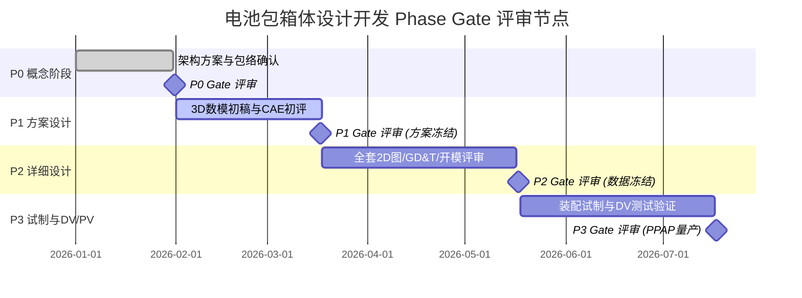

# 动力电池包箱体设计全阶段评审与管控标准汇总手册
*(Battery Pack Housing Design Stage Review & Control Master Guide)*

---

## 目录
1. [评审流程与制度规范](#1-评审流程与制度规范)
2. [风险分级与判定评分标准](#2-风险分级与判定评分标准)
3. [电池包箱体设计评审总表 (50+检查项)](#3-电池包箱体设计评审总表)
   - [3.1 物理包络与整车接口](#31-物理包络与整车接口)
   - [3.2 结构强度、刚度与碰撞安全](#32-结构强度刚度与碰撞安全)
   - [3.3 密封防护、平压与爆破排气](#33-密封防护平压与爆破排气)
   - [3.4 热管理系统集成与液冷板](#34-热管理系统集成与液冷板)
   - [3.5 电气安全、绝缘与 EMC 接地](#35-电气安全绝缘与-emc-接地)
   - [3.6 材料选型、防腐与轻量化](#36-材料选型防腐与轻量化)
   - [3.7 可制造性设计 (DFM)](#37-可制造性设计-dfm)
   - [3.8 可装配性与售后可维护性 (DFA/DFS)](#38-可装配性与售后可维护性-dfadfs)
4. [Phase Gate 阶段冻结节点与交付物清单](#4-phase-gate-阶段冻结节点与交付物清单)
5. [国内外关键法规与行业标准对照表](#5-国内外关键法规与行业标准对照表)
6. [评审问题整改追踪闭环表 (模板)](#6-评审问题整改追踪闭环表-模板)

---

## 1. 评审流程与制度规范

### 1.1 目的
本规范旨在建立新能源动力电池包箱体（包含上盖、下箱体/下托盘、内部横纵梁架构、水冷板集成及底护板）在产品开发过程中的质量把控标准，防范在试制、测试及量产阶段发生结构失效、密封泄漏、防爆失效或制造冲压/焊接/装配干涉等重大风险。

### 1.2 评审适用对象
适用于 **纯电动 (BEV)**、**插电混动/增程 (PHEV/REEV)** 及 **商用车/储能电池包** 的以下结构组件：
- **下箱体总成 (Tray Assembly)**：压铸铝箱体、铝型材FSW焊接箱体、冲压钢/铝箱体。
- **上盖总成 (Top Cover)**：SMC/HP-RTM复合材料上盖、冲压钢/铝上盖。
- **保护底板 (Underbody Shield)**：高强钢/复材/铝合金底护板。
- **内部结构与密封**：电芯/模组固定横纵梁、冷却板、密封胶条与防爆平压阀。

### 1.3 评审阶段划分 (Gate Reviews)
*   **P0 阶段（概念与架构方案）**：确定箱体物理包络、整车安装接口、承载路线、基本材料与工艺路线。
*   **P1 阶段（方案设计初稿）**：完成3D数模初稿、全工况CAE仿真初评、DFM/DFA初步评估。
*   **P2 阶段（详细设计与数据冻结）**：3D/2D工程图纸完成、公差分析(GD&T)完成、CAE全工况闭环、模具/工装开模评审。
*   **P3 阶段（试制验证与DV/PV）**：装配试制验证、DV样品测试、问题点闭环与量产批准 (PPAP)。

---

## 2. 风险分级与判定评分标准

### 2.1 风险等级分类 (Risk Severity Level)

> [!IMPORTANT]
> **高风险 (H - Critical)**：
> 涉及到强标法规（如 GB 38031 挤压/热扩散/防护）、严重安全隐患（高压击穿、燃爆泄压阻塞）、干涉无法装配或工艺无法实现（如焊枪不可达）。必须在当前Gate节点前完全闭环，否则**否决通过**。

> [!WARNING]
> **中风险 (M - Major)**：
> 影响局部结构刚度/模态性能、降低防腐寿命（如异种金属电化学防护缺陷）、增加制造成本或装配工时超标。需制定整改Plan并于下一Gate节点前验证。

> [!NOTE]
> **低风险 (L - Minor)**：
> 图纸标注规范性问题、不影响功能的非关键公差优化、外观优化项。可随图纸迭代修正。

### 2.2 阶段评审通过准则 (Gate Standard)
$$ \text{Pass Condition} = \begin{cases} \text{Pass} & \text{High Risk}=0 \text{ 且 } \text{Medium Risk Closed Rate} \ge 90\% \\ \text{Conditional Pass} & \text{High Risk}=0 \text{ 需提供短期避险方案} \\ \text{Reject} & \text{High Risk} \ge 1 \end{cases} $$

---

## 3. 电池包箱体设计评审总表

### 3.1 物理包络与整车接口

| 序号 | 评审项目 | 设计控制标准与要求 | 阶段 | 验证手段 | 风险 | 评审结论 | 责任人/整改意见 |
| :--- | :--- | :--- | :--- | :--- | :--- | :--- | :--- |
| 1.1 | 箱体总包络与动态间隙 | 极限过坑与底盘跳动下，箱体外壁与车身/悬挂动态间隙 $\ge 15\text{mm}$（关键受击面 $\ge 25\text{mm}$）。 | P0/P1 | 3D运动包络分析 | **H** | ☐通过 ☐需修改 | |
| 1.2 | 挂点螺栓接口与过孔 | 固定悬挂脚耳（Lug）数量与分布匹配底盘载荷，螺栓沉头空间与过孔（如过孔比螺栓大 $2\text{mm}$）满足公差链。 | P0/P2 | 3D干涉 / 螺栓预紧力计算 | **H** | ☐通过 ☐需修改 | |
| 1.3 | Z向离地间隙与防刮底 | 下箱体底面离地间隙符合整车离地要求，箱体前端及受击边缘设置引导滑块或防击穿加强结构。 | P1/P2 | 3D测量 / 碰撞仿真 | **H** | ☐通过 ☐需修改 | |
| 1.4 | MSD与高低压插件开孔 | MSD、高压连接器、低压哈丁接口开孔尺寸、定位销、紧固螺纹及密封沉孔符合规格，手势及工具无干涉。 | P1/P2 | 3D人机与工具避让仿真 | **H** | ☐通过 ☐需修改 | |
| 1.5 | 吊装与搬运结构 | 箱体外侧预留吊装孔/抓取结构，搬运及吊装时可承受 $\ge 3\text{G}$ 自重+模组全载载荷无永久变形。 | P1/P2 | 吊装有限元分析 (FEA) | **M** | ☐通过 ☐需修改 | |

### 3.2 结构强度、刚度与碰撞安全

| 序号 | 评审项目 | 设计控制标准与要求 | 阶段 | 验证手段 | 风险 | 评审结论 | 责任人/整改意见 |
| :--- | :--- | :--- | :--- | :--- | :--- | :--- | :--- |
| 2.1 | 整体模态与自由振动 | 满载下箱体一阶弯曲与扭转模态 $\ge 35\text{Hz}$（电动车建议 $\ge 40\text{Hz}$），避开电机与底盘激振频率区。 | P1/P2 | 模态仿真 (FEA) / 扫频测试 | **H** | ☐通过 ☐需修改 | |
| 2.2 | 随机振动与疲劳寿命 | 满足 $3\text{D}$ 随机振动 PSD 曲线（如 100h 振动），受力焊缝及紧固件应力小于材料疲劳极限，无开裂损伤。 | P1/P2 | 振动疲劳仿真 / 振动台测试 | **H** | ☐通过 ☐需修改 | |
| 2.3 | 侧碰/柱碰抗挤压能力 | 依据 GB 38031 / ECE R100，侧向加载 $100\text{kN}/200\text{kN}$ 或侧面柱碰下，边梁变形量不得侵入电芯/模组区域。 | P1/P2 | LS-DYNA 非线性碰撞仿真 | **H** | ☐通过 ☐需修改 | |
| 2.4 | 底部击穿与球击性能 | 底部承受 $100\text{J}/150\text{J}$ 尖锐物体冲击（或落锤冲击）后，箱体底板不得穿孔，受挤压变形量小于安全间隙。 | P1/P2 | 碰撞击穿仿真 / 跌落试验 | **H** | ☐通过 ☐需修改 | |
| 2.5 | 内部模组固定梁强度 | 内部横纵梁固定电芯/模组螺栓预埋攻丝深度符合铝/钢咬合规范（铝合金咬合深度 $\ge 1.5d$），攻丝拉拔力超标。 | P2 | 螺栓拉拔计算 / FEA | **H** | ☐通过 ☐需修改 | |
| 2.6 | 上盖堆叠与顶压性能 | 上盖能承受堆叠仓储压力及维修踩踏载荷（如 $100\text{kg}$ 点载荷），残余变形符合密封要求。 | P2 | 顶压静载仿真 | **M** | ☐通过 ☐需修改 | |

### 3.3 密封防护、平压与爆破排气

| 序号 | 评审项目 | 设计控制标准与要求 | 阶段 | 验证手段 | 风险 | 评审结论 | 责任人/整改意见 |
| :--- | :--- | :--- | :--- | :--- | :--- | :--- | :--- |
| 3.1 | 防护等级 (IP67/IP68/IP6K9K) | 上盖与下箱体接合面密封面宽度 $\ge 12\text{mm}$，密封胶条/FIPG压缩率控制在 $30\% \sim 50\%$，螺栓间距 $\le 60\sim 80\text{mm}$。 | P1/P2 | 链式公差分析 / 气密性测试 | **H** | ☐通过 ☐需修改 | |
| 3.2 | 平压阀 (Breather Valve) | 选型透气量匹配充放电及温差引起的气压变化；防泼践安装，IP67/IP6K9K防护，避免洗车高压水枪直冲。 | P1/P2 | 通气量计算 / 水冲刷检查 | **H** | ☐通过 ☐需修改 | |
| 3.3 | 热失控防爆排气设计 | 爆破阀动作压力（如 $20 \sim 50\text{kPa}$）匹配电芯热失控最大产气速率；排气通道无阻挡，排气口定向朝向车外下方。 | P1/P2 | 热失控 CFD 流场与压强仿真 | **H** | ☐通过 ☐需修改 | |
| 3.4 | 密封面平面度与粗糙度 | 密封面整体平面度受控，局部平面度 $\le 0.5\text{mm}/300\text{mm}$，粗糙度 $Ra \le 3.2\mu\text{m}$，确保密封胶附着。 | P2 | 2D工程图 GD&T 标注检查 | **M** | ☐通过 ☐需修改 | |
| 3.5 | 高压水枪冲刷唇口 | 箱体接合面防高压水冲刷，设计挡水唇口或凹槽防直接水流射入密封胶线。 | P2 | 3D截面结构检查 | **M** | ☐通过 ☐需修改 | |

### 3.4 热管理系统集成与液冷板

| 序号 | 评审项目 | 设计控制标准与要求 | 阶段 | 验证手段 | 风险 | 评审结论 | 责任人/整改意见 |
| :--- | :--- | :--- | :--- | :--- | :--- | :--- | :--- |
| 4.1 | 水冷板结构集成 | 水冷板（Bottom Cold Plate）一体化钎焊或贴附结构强度足够，承压测试（爆破压力 $\ge 1.2\text{MPa}$）。 | P1/P2 | 压力流体测试 / CFD | **H** | ☐通过 ☐需修改 | |
| 4.2 | 导热界面材料 (TIM) 公差 | 导热胶/导热垫厚度设计考虑公差链，最小厚度防止击穿，最大厚度下导热热阻在设计许用范围内。 | P2 | 三维公差分析 (Tolerance Stack) | **H** | ☐通过 ☐需修改 | |
| 4.3 | 上盖内侧云母/防火涂层 | 上盖内侧覆盖防火云母板或耐火焰冲刷涂层，保证热失控 $1000^\circ\text{C}$ 喷射下 $5\text{min}$ 内上盖不烧穿。 | P1/P2 | 燃烧试验 / 热仿真 | **H** | ☐通过 ☐需修改 | |
| 4.4 | 内部防冷凝水集水设计 | 箱体内部电气元器件垫高，底部留有冷凝水收集及防积水隔离流道。 | P2 | 3D结构分析 | **M** | ☐通过 ☐需修改 | |

### 3.5 电气安全、绝缘与 EMC 接地

| 序号 | 评审项目 | 设计控制标准与要求 | 阶段 | 验证手段 | 风险 | 评审结论 | 责任人/整改意见 |
| :--- | :--- | :--- | :--- | :--- | :--- | :--- | :--- |
| 5.1 | 电气间隙与爬电距离 | 内部高压铜排、高压连接器与箱体金属壁之间的空间距离（空间间隙 $\ge 10 \sim 15\text{mm}$，爬电距离 $\ge 15 \sim 25\text{mm}$）。 | P1/P2 | 3D安全间隙球 (Clearance) 剖析 | **H** | ☐通过 ☐需修改 | |
| 5.2 | 等电位接地搭铁设计 | 下箱体、上盖、内部横梁、水冷板之间均有可靠的螺纹搭铁或接地软铜线，跨接电阻 $< 10\text{m}\Omega$。 | P2 | 图纸搭铁标注 / 电阻测试 | **H** | ☐通过 ☐需修改 | |
| 5.3 | 内壁绝缘防护层 | 金属箱体内壁靠近模组正负极极柱区域贴附 PET 绝缘膜或喷涂绝缘漆（耐压 $\ge 2500\text{V DC}/1\text{min}$）。 | P2 | 绝缘击穿电压测试 | **H** | ☐通过 ☐需修改 | |
| 5.4 | 过线孔锐边防护 | 线束穿过横梁或箱体开孔时，孔边缘包覆橡胶护套或翻边处理，消除锐边划伤线束风险。 | P2 | 3D截面与线束走向检查 | **M** | ☐通过 ☐需修改 | |

### 3.6 材料选型、防腐与轻量化

| 序号 | 评审项目 | 设计控制标准与要求 | 阶段 | 验证手段 | 风险 | 评审结论 | 责任人/整改意见 |
| :--- | :--- | :--- | :--- | :--- | :--- | :--- | :--- |
| 6.1 | 材料力学性能匹配 | 挤压铝（6005A-T6/6061-T6）、铸铝（A356/AlSi10MnMg）、高强钢材料屈服及抗拉强度符合 CAE 计算基准。 | P0/P1 | 材料试验报告 (Mill Certificate) | **M** | ☐通过 ☐需修改 | |
| 6.2 | 异种金属电化学腐蚀 | 钢-铝、铜-铝搭接面必须加装绝缘垫片或使用达克罗/锌镍涂层螺栓，防止双金属电化学腐蚀。 | P2 | 盐雾试验与腐蚀规范审查 | **H** | ☐通过 ☐需修改 | |
| 6.3 | 下箱体防腐与防石击 | 箱体底部外表面采用电泳+PVC喷涂或抗石击涂层，满足中性盐雾测试 $\ge 720\text{h} \sim 1000\text{h}$ 无红锈。 | P2 | 涂层耐腐蚀试验规范 | **M** | ☐通过 ☐需修改 | |
| 6.4 | 轻量化目标达成 | 箱体结构质量（下箱体+上盖+梁+水冷板）满足电池系统能量密度与整车轻量化质量指标要求。 | P1/P2 | 3D数模质量属性统计 | **M** | ☐通过 ☐需修改 | |

### 3.7 可制造性设计 (DFM)

| 序号 | 评审项目 | 设计控制标准与要求 | 阶段 | 验证手段 | 风险 | 评审结论 | 责任人/整改意见 |
| :--- | :--- | :--- | :--- | :--- | :--- | :--- | :--- |
| 7.1 | 搅拌摩擦焊 (FSW) 焊缝 | FSW 焊缝位置退刀孔避开密封区；焊缝下方具备足够的受压支撑背台，防止焊接时箱体底板压溃。 | P1/P2 | 焊接夹具与焊头避让仿真 | **H** | ☐通过 ☐需修改 | |
| 7.2 | MIG/TIG 焊枪可达性 | 熔化极气体保护焊（MIG）焊缝角度（$\ge 45^\circ$）良好，焊枪与箱体侧壁无干涉，避开封闭腔体不可焊区域。 | P1/P2 | 3D焊枪姿态避让仿真 | **H** | ☐通过 ☐需修改 | |
| 7.3 | 压铸件壁厚与模流 | 压铸下箱体壁厚均匀（$3 \sim 5\text{mm}$），脱模斜度 $\ge 1.5^\circ \sim 2^\circ$，模流分析无严重气孔、冷隔缺陷。 | P2 | 模流分析 (Moldflow) | **M** | ☐通过 ☐需修改 | |
| 7.4 | 拉铆/SPR/FDS 点距边距 | 自冲铆（SPR）、拉铆螺母与热融自攻螺钉（FDS）边距 $\ge 2.5d$，铆枪压头包络无物理干涉。 | P2 | 铆接工装仿真 | **H** | ☐通过 ☐需修改 | |
| 7.5 | CNC 加工基准与余量 | 铸造/型材箱体机加工基准孔统一，CNC 刀具行程与下刀切削路径无干涉，关键孔壁厚余量充足。 | P2 | 图纸 GD&T 及加工路向检查 | **M** | ☐通过 ☐需修改 | |

### 3.8 可装配性与售后可维护性 (DFA/DFS)

| 序号 | 评审项目 | 设计控制标准与要求 | 阶段 | 验证手段 | 风险 | 评审结论 | 责任人/整改意见 |
| :--- | :--- | :--- | :--- | :--- | :--- | :--- | :--- |
| 8.1 | 电芯/模组装入斜面导向 | 模组/CTP单元装入箱体设有倒角或斜面导向，模组与箱体梁单边装配间隙 $\ge 2 \sim 3\text{mm}$。 | P2 | 3D虚拟装配插拔仿真 | **H** | ☐通过 ☐需修改 | |
| 8.2 | 螺栓拧紧工具避让空间 | 螺栓沉头避让空间外径 $\ge D_{\text{套筒}}+10\text{mm}$，垂直高度满足气动/电动拧紧枪垂直深入操作。 | P2 | 工具包络干涉检查 | **H** | ☐通过 ☐需修改 | |
| 8.3 | 结构防错设计 (Poka-Yoke) | 非对称部件（如上盖定位销、左右挂脚、高低压防护罩）具备物理防错结构，防止反向或错位安装。 | P2 | 3D防错模拟审查 | **M** | ☐通过 ☐需修改 | |
| 8.4 | 售后拆卸与重新密封 (DFS) | 支持售后拆卸上盖修理内部组件，密封胶具备残胶刮除工艺性，螺栓不采用不可逆破坏性连接。 | P2/P3 | 售后拆装工时与维修评估 | **M** | ☐通过 ☐需修改 | |

---

## 4. Phase Gate 阶段冻结节点与交付物清单

### 阶段 Gate 交付清单 (Deliverable Checklist)

#### Gate 0 (P0 概念阶段冻结)
- [ ] 箱体边界包络与整车空间干涉检查报告
- [ ] 箱体结构承载路线与材料路线选择说明书
- [ ] 机械/电气/热接口控制文件 (ICD 初稿)

#### Gate 1 (P1 方案设计冻结)
- [ ] 3D 结构设计数模（初稿）
- [ ] CAE 基础工况仿真报告（模态、挤压、静强度）
- [ ] 供应商 DFM 工艺可行性评估报告 (FSW/压铸/型材)
- [ ] 密封胶条及压敏计算初稿

#### Gate 2 (P2 数据冻结与开模批准)
- [ ] 3D 正式数模与 2D 工程图纸（标注完整 GD&T）
- [ ] CAE 全工况仿真闭环报告（包含随机振动疲劳、碰撞、爆破排气流场 CFD）
- [ ] 尺寸公差分析与累积报告 (Tolerance Stack-up)
- [ ] 电气间隙/爬电距离 3D 剖析报告
- [ ] 全装配过程工具及手势避让仿真分析报告

#### Gate 3 (P3 试制验证与 PPAP 批准)
- [ ] 试制样品装配及 DFM/DFA 问题点闭环报告
- [ ] DV 试验（气密、振动、海水浸泡、热扩散、挤压）合格报告
- [ ] 工装及模具尺寸测量报告 (FAIR / CPK)
- [ ] 量产 PPAP 批准文件

---

## 5. 国内外关键法规与行业标准对照表

| 标准编号 | 标准名称 | 核心条款与对箱体设计的要求 |
| :--- | :--- | :--- |
| **GB 38031-2020** | 电动汽车用动力蓄电池安全要求 | 包含下箱体挤压（100kN）、跌落、海水浸泡、振动、外部火烧及热扩散 $5\text{min}$ 不起火爆炸要求。 |
| **ECE R100.03** | 联合国欧洲经济委员会动力电池安全法规 | 涵盖碰撞安全（侧碰/后碰挤压）、绝缘电阻（$> 500\Omega/\text{V}$）、防水防尘。 |
| **GB/T 4208** | 外壳防护等级 (IP代码) | 规定箱体及接口需达到 IP67、IP68、IP6K9K（高压热冲刷防护）。 |
| **QC/T 1156** | 电动汽车用动力电池箱体通用技术条件 | 规定箱体耐盐雾腐蚀、密封性、机械强度及气密性测试方法。 |
| **ISO 16750** | 道路车辆 电气及电子设备环境条件 | 规定箱体在环境机械振动、冲击及冷热冲击（$-40^\circ\text{C} \sim +85^\circ\text{C}$）下的耐久规范。 |
| **UL 2580** | 电动汽车电池安全标准 | 包含机械压溃、挤压、下底板抗击穿性能。 |

---

## 6. 评审问题整改追踪闭环表 (模板)

**项目名称**：____________________ &nbsp;&nbsp;&nbsp;&nbsp; **电池包型号**：____________________ &nbsp;&nbsp;&nbsp;&nbsp; **评审阶段**：[ ]P0  [ ]P1  [ ]P2  [ ]P3

| 问题编号 | 关联章节 | 问题描述与工程缺陷截图 | 风险等级 | 拟定整改方案 | 责任人 | 计划完成日期 | 验证手段与闭环状态 |
| :--- | :--- | :--- | :---: | :--- | :---: | :---: | :---: |
| ISS-001 | 3.1 物理包络 | 下箱体左侧挂脚在碰撞退让后与整车纵梁间隙仅8mm | 高 (H) | 挂脚向内缩进5mm，加大倒角 | 张工 | 2026-08-05 | ☐待验证 ☐已闭环 |
| ISS-002 | 3.3 密封防护 | 爆破阀喷射口正对左侧低压线束 | 高 (H) | 调整爆破阀角度向下倾斜30度 | 李工 | 2026-08-03 | ☐待验证 ☐已闭环 |
| ISS-003 | 3.7 可制造性 | FSW焊接退刀孔边缘与密封胶线重叠1.5mm | 高 (H) | 焊缝端头延伸10mm避开胶线 | 王工 | 2026-08-08 | ☐待验证 ☐已闭环 |
| ISS-004 | 3.5 电气安全 | 铜排转角处距铝箱体侧壁净空间隙仅9.2mm | 高 (H) | 加贴PET绝缘板或修剪铜排 | 赵工 | 2026-08-04 | ☐待验证 ☐已闭环 |
| ISS-005 | 3.8 可装配性 | 螺栓B12拧紧套筒垂直高度受压铸角件阻挡 | 中 (M) | 避让沉头沉深增加3mm | 陈工 | 2026-08-10 | ☐待验证 ☐已闭环 |

---
*手册编制部门：电池包结构系统工程部 / 质量保证部*
